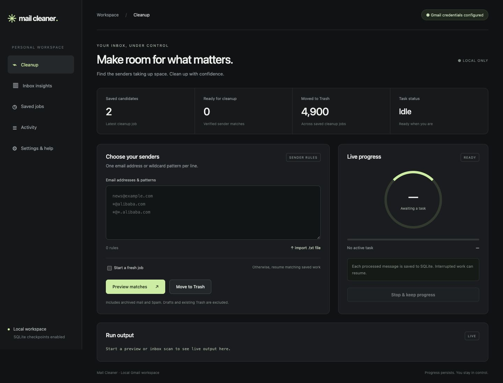
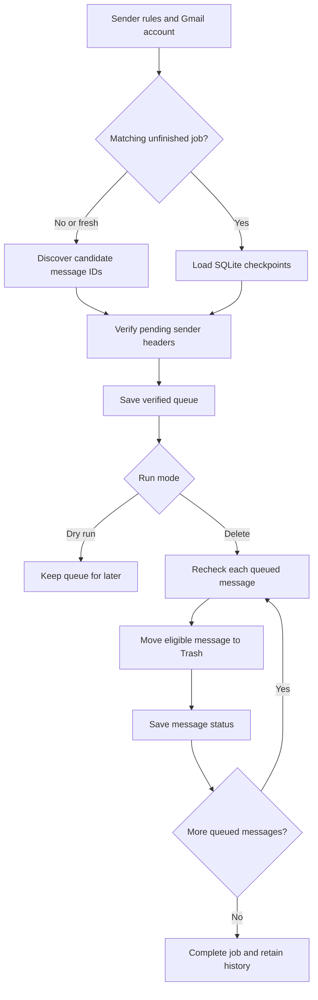
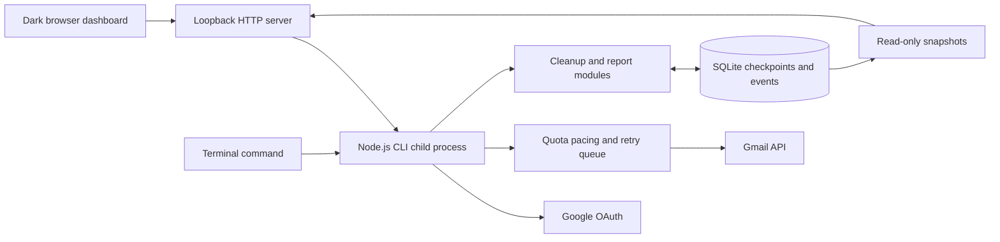

# Mail Cleaner

**A local Gmail cleanup workspace with a dark dashboard, sender rules, and resumable SQLite jobs.**

Find frequent senders, preview matching messages, and move unwanted mail to Trash. Use the browser dashboard or the Node.js CLI. Progress is saved after each processed message so long-running jobs can recover from interruptions.



[Quick start](#quick-start) · [Dashboard](#dashboard) · [CLI reference](#cli-reference) · [Recovery](#saved-jobs-and-recovery) · [Troubleshooting](#troubleshooting)

## What you can do

- Match exact sender addresses or wildcard patterns, individually or from a text file.
- Preview verified matches and sample subjects before choosing a cleanup run.
- Move matched messages to Gmail Trash with a fresh eligibility check per message.
- Resume interrupted scans and deletions using SQLite checkpoints.
- Rank the most frequent senders in your Inbox.
- Follow progress, remaining-time estimates, API pauses, and diagnostic events.
- Use the same processing engine from a local dashboard or terminal.

## Quick start

### 1. Install

Use Node.js 20 or later and npm. SQLite uses the native `better-sqlite3` package, which may require your platform's build tools when a compatible prebuilt binary is unavailable.

```sh
git clone https://github.com/mrxtan/mailCleaner.git
cd mailCleaner
npm ci
cp .env.example .env
```

### 2. Configure Google authorization

1. Create or select a Google Cloud project and enable **Gmail API**.
2. Configure **Google Auth Platform**. For a personal Gmail account, select **External** and add your Gmail address under **Audience → Test users** while the app is in Testing.
3. Under **Clients**, create an OAuth client with application type **Desktop app**.
4. Copy its client ID and client secret into your local `.env`.

```dotenv
GOOGLE_CLIENT_ID=your-client-id.apps.googleusercontent.com
GOOGLE_CLIENT_SECRET=your-client-secret
GOOGLE_REFRESH_TOKEN=
```

The first task opens Google sign-in. After approval, the app saves a refresh token in `token.json`. Subsequent runs reuse it. `GOOGLE_REFRESH_TOKEN` is optional and takes precedence over the saved token. The app requests the `gmail.modify` OAuth scope.

Follow Google's setup guide for the current console screens. [Gmail Node.js quickstart](https://developers.google.com/workspace/gmail/api/quickstart/nodejs)

### 3. Open the dashboard

```sh
npm run ui
```

Open **[http://127.0.0.1:3210](http://127.0.0.1:3210)**. Add sender rules or import a `.txt` file, then choose **Preview matches**. Choose **Move to Trash** when ready.

For a terminal preview, run the following command from the project directory.

```sh
node index.js --sender newsletter@example.com --dry-run
```

## Dashboard

| View | Available actions |
| --- | --- |
| Cleanup | Enter rules, import sender files, preview matches, start a fresh job, move matches to Trash, follow progress, and stop a dashboard task while retaining checkpoints |
| Inbox insights | Scan Inbox, choose the ranking size, start a fresh report, inspect partial or completed rankings, and add a sender to cleanup rules |
| Saved jobs | Inspect saved phases and counts, then load a job's sender rules for preview or cleanup |
| Activity | Review persisted retry, failure, and completion events |
| Settings & help | Set the quota budget and token/database paths, review OAuth setup, wildcard examples, and recovery behavior |

The dashboard binds to `127.0.0.1`. Keep the server running while a task executes. Closing the browser leaves a dashboard task running. **Stop & keep progress** controls the child process started by the dashboard. Terminal jobs run independently.

The UI reads saved SQLite data, including data written by a terminal job. Live output belongs to the latest task started through the dashboard. Loading an older job's rules resumes the latest unfinished job with that same account and rule set.

Use `MAIL_CLEANER_PORT` to choose another port.

```sh
MAIL_CLEANER_PORT=3211 npm run ui
```

## CLI reference

```sh
node index.js --help
```

| Option | Behavior |
| --- | --- |
| `--sender PATTERN` | One exact address or wildcard pattern |
| `--file PATH` | UTF-8 sender file, one address or pattern per line |
| `--dry-run` | Preview mode, enabled by default |
| `--delete` | Verify matches, then automatically move them to Trash |
| `--scan-inbox` | Run the standalone inbox sender report |
| `--top NUMBER` | Number of ranked senders, default `20` |
| `--fresh` | Create a new job or report using current mail |
| `--quota-per-minute UNITS` | API budget, default `5400`, minimum `20` |
| `--database PATH` | SQLite location, normally `mail-cleaner.sqlite` for cleanup and `inbox-report.sqlite` for reports |
| `--token PATH` | OAuth token location, default `token.json` |
| `--help`, `-h` | Print detailed usage |

### Preview and cleanup

```sh
# Preview one sender
node index.js --sender newsletter@example.com --dry-run

# Reuse that saved queue for cleanup
node index.js --sender newsletter@example.com --delete

# Process a sender file
node index.js --file senders.txt --dry-run
node index.js --file senders.txt --delete

# Combine a file and an additional rule
node index.js --file senders.txt --sender '*@example.com' --dry-run

# Discover current mail in a new job
node index.js --file senders.txt --dry-run --fresh
```

Cleanup searches archived mail and Spam as well as Inbox. Drafts and existing Trash are excluded. Each individual message's `From` address is checked. Ambiguous headers and multiple senders are skipped. Cleanup moves messages to Trash, where Gmail's normal recovery and retention behavior applies.

### Sender files and wildcards

Copy the included example and edit your rules.

```sh
cp senders.example.txt senders.txt
```

```text
# Exact sender
newsletter@example.com

# Exact domain
*@alibaba.com

# Subdomains
*@*.alibaba.com
```

Blank lines and whole-line comments beginning with `#` are ignored. Matching ignores capitalization. Duplicate rules and overlapping message IDs are deduplicated.

| Pattern | Matches |
| --- | --- |
| `news@example.com` | That full address |
| `*@alibaba.com` | Any sender at exactly `alibaba.com` |
| `*@*.alibaba.com` | Senders at subdomains such as `notice.alibaba.com` |
| `*@*alibaba*.com` | Domains containing `alibaba`, including `notalibaba.com` |
| `*.@alibaba.com` | Addresses with a literal dot immediately before `@` |

`*` matches zero or more characters within either side of `@`. Repeated stars behave like one star. Dots are literal. Quote patterns in shell commands so your shell passes them unchanged.

**Wildcard mode inspects all eligible mailbox messages.** Its initial candidate count can greatly exceed the verified match count. The final deletion count and deletion ETA appear after verification.

### Inbox sender report

```sh
node index.js --scan-inbox --top 20
```

This ranks addresses by individual message count in the current Inbox, including read mail. It excludes archived messages, Spam, Trash, and drafts. Counts reflect observations during the scan as messages may arrive, move, or disappear.

Interrupted reports resume from their saved checkpoints. Completed reports remain stored, and a subsequent invocation starts a new report. `--fresh` starts over. Use report mode independently of sender rules and cleanup flags.

## Saved jobs and recovery

Repeat the same command after an interruption. Jobs are matched using the authenticated Gmail account and normalized sender patterns. Pattern order does not matter. Changing the pattern set creates a separate job.



| State | Meaning |
| --- | --- |
| `pending` | Awaiting sender verification |
| `matched` | Verified and queued for cleanup |
| `excluded` | Failed verification or disappeared during scanning |
| `trashed` | Gmail confirmed the Trash operation |
| `skipped` | Missing or ineligible during the deletion recheck |

Discovery saves IDs page by page. If interrupted, it repeats listing and deduplicates the IDs already saved. Verification and deletion checkpoint each message individually.

If Gmail moves a message to Trash immediately before a process interruption, the next run sees its Trash label and skips another mutation. This can appear as `skipped` in the final summary.

One writer can use a database at a time. A lock left by a crashed process becomes stale after five minutes. Completed jobs are retained for history. A later run starts a new job. Saved queues cover the messages already discovered; use `--fresh` to include newly arrived mail.

## Quotas, progress, and estimates

Requests are processed sequentially with a default budget of **5,400 quota units per minute**. Choose a budget appropriate to your Google Cloud project's quota and any other clients using it. Concurrent terminal and dashboard commands share the Gmail account's quota.

The implementation budgets 5 units for listing, 20 for a metadata check, and 20 for a Trash operation. A cleanup rechecks every queued message before deletion, so that phase budgets 40 units per message. Google publishes the current costs and project limits. [Gmail API usage limits](https://developers.google.com/workspace/gmail/api/reference/quota)

At the default budget, an illustrative queue of 60,000 matching messages needs approximately **222 minutes for verification** and **444 minutes for rechecking and moving to Trash**, plus discovery, network delays, and retries. A saved dry run lets a later deletion run reuse the initial verification.

Progress prints every 100 messages and at phase completion. ETA uses the quota budget and observed processing speed. Sleeping computers, slow requests, and retry pauses can increase estimates.

Rate-limit errors pause for at least one minute. Transient failures, including aborted requests, retry up to ten times with backoff and respect `Retry-After`. Requests use a 60-second timeout. Exhausted retries leave the job available for recovery.

On macOS, keep the machine plugged in and the lid open. You can prevent idle sleep for a command with the following invocation.

```sh
caffeinate -i node index.js --file senders.txt --delete
```

## Architecture



| Location | Responsibility |
| --- | --- |
| `index.js` | CLI entry point and authenticated task dispatch |
| `dashboard.js` | Local web server and CLI process management |
| `web/` | Dashboard HTML, CSS, and browser interactions |
| `lib/config.js`, `lib/help.js` | Argument validation and CLI help |
| `lib/auth.js` | OAuth and token persistence |
| `lib/patterns.js`, `lib/sender.js` | Rule parsing and sender matching |
| `lib/discover.js` | Candidate listing and deduplication |
| `lib/jobs.js` | Resumable cleanup workflow |
| `lib/report.js` | Inbox sender ranking workflow |
| `lib/storage.js` | SQLite schema, locking, and events |
| `lib/dashboard-data.js` | Read-only dashboard data |
| `queue.js` | Request pacing, retries, and progress estimates |
| `test/` | Mocked Gmail and SQLite regression tests |

## Local data and Git

| File | Contains |
| --- | --- |
| `.env` | OAuth client settings and optional refresh token |
| `token.json` | Saved refresh token and OAuth client ID |
| `mail-cleaner.sqlite` | Cleanup jobs, sender patterns, message IDs, states, and events |
| `inbox-report.sqlite` | Report checkpoints and sender addresses |
| `senders.txt` | Your personal sender rules |

These local files, SQLite sidecars, dependencies, and logs are covered by `.gitignore`. `.env.example` and `senders.example.txt` are committed as setup templates. Add any custom secret-file paths to `.gitignore` before committing.

Database events contain selected error metadata. Sample subjects and senders appear in terminal/dashboard output. Email bodies and attachments are not fetched by the scan. The dashboard reads your local databases and runs locally on your Mac or development machine.

## Troubleshooting

| Symptom | What to do |
| --- | --- |
| Google reports `403 access_denied` during testing | Add the signing-in Gmail address to the OAuth project's test users |
| Google reports `invalid_grant` | Remove the saved token, clear any `GOOGLE_REFRESH_TOKEN` override, and authorize again |
| A request aborts or the network fails | Allow the retry queue to run; if it exits, repeat the same command to resume |
| Database is locked | Check for another writer; after a crashed process, allow the stale lock interval to pass |
| Wildcard discovery finds the whole mailbox | This is the candidate pool; sender verification determines the actual queue |
| New messages are absent from a resumed job | Use `--fresh` to create a new snapshot of current candidates |
| Dashboard refuses a different hostname | Open the exact printed `http://127.0.0.1:PORT` URL |
| Native SQLite installation fails | Check the Node version and install the platform build tools required by the package |

Inspect recent diagnostics with SQLite's command-line tool.

```sh
sqlite3 mail-cleaner.sqlite \
  'SELECT time, kind, details FROM events ORDER BY id DESC LIMIT 20;'
```

## Development

```sh
npm run check
npm test
```

The tests use mocked Gmail responses and temporary databases. They cover matching, retry pacing, interrupted scan recovery, dry-run reuse, recovery after a successful Trash call, and resumable inbox rankings. They can run without Gmail credentials.

The dashboard includes input validation and same-origin action checks. Live Gmail behavior also depends on the account's authorization, quota, and current mailbox state.
